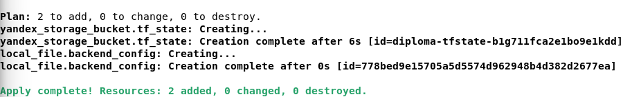
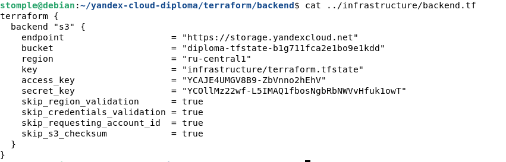
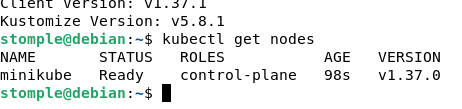
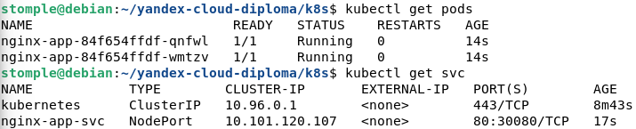
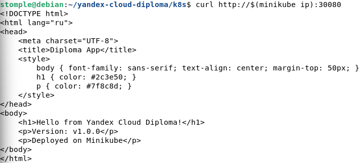
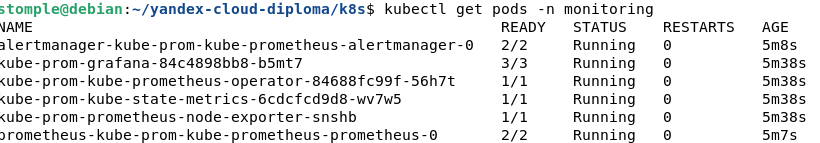
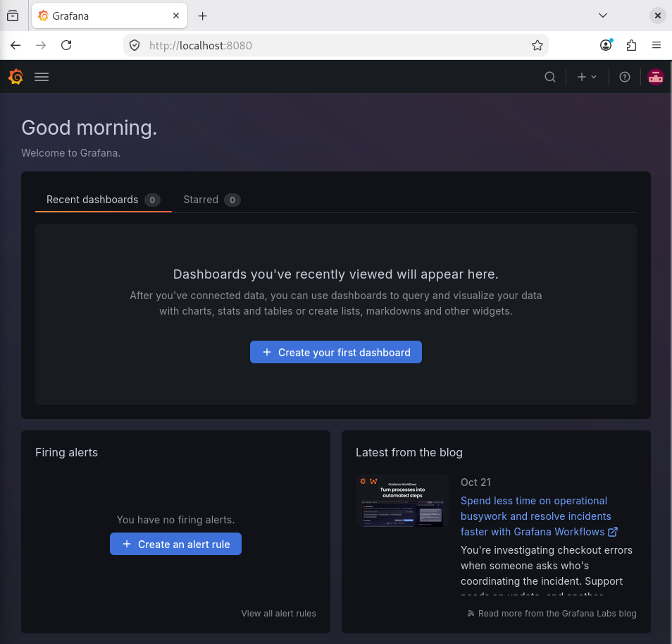
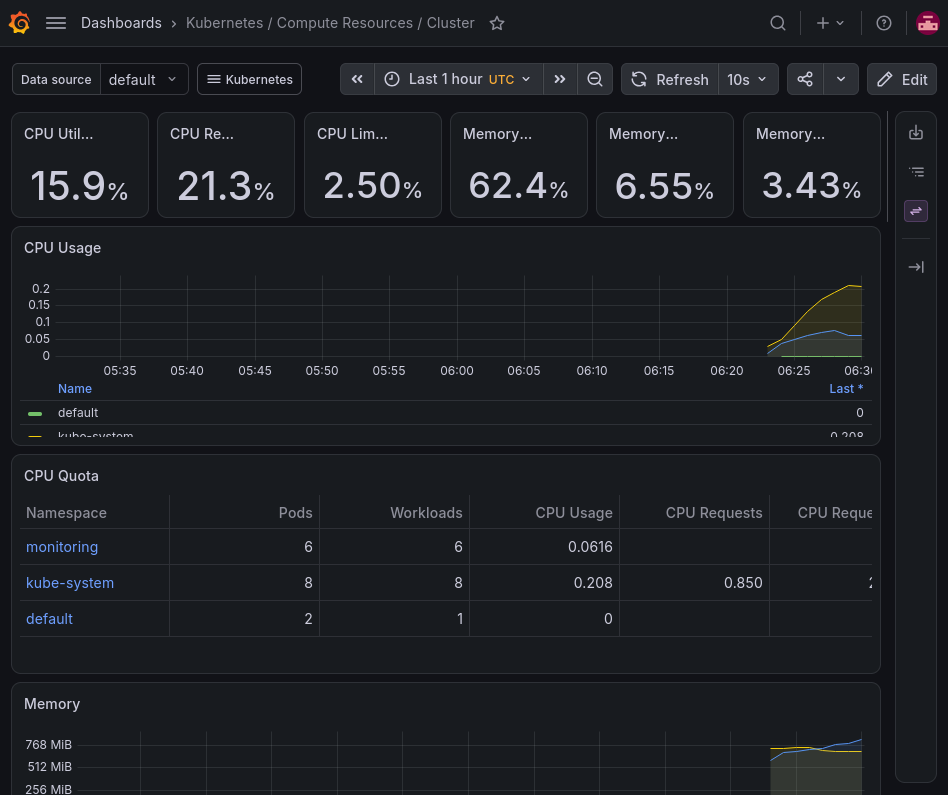
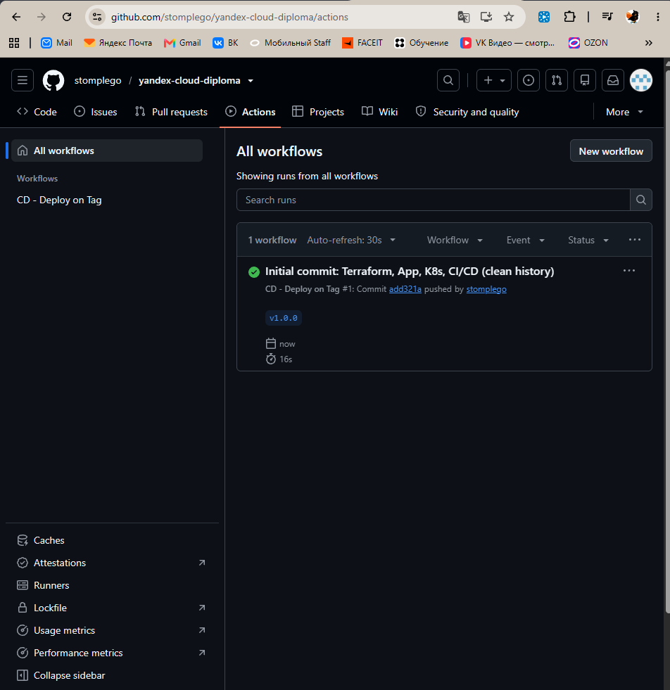
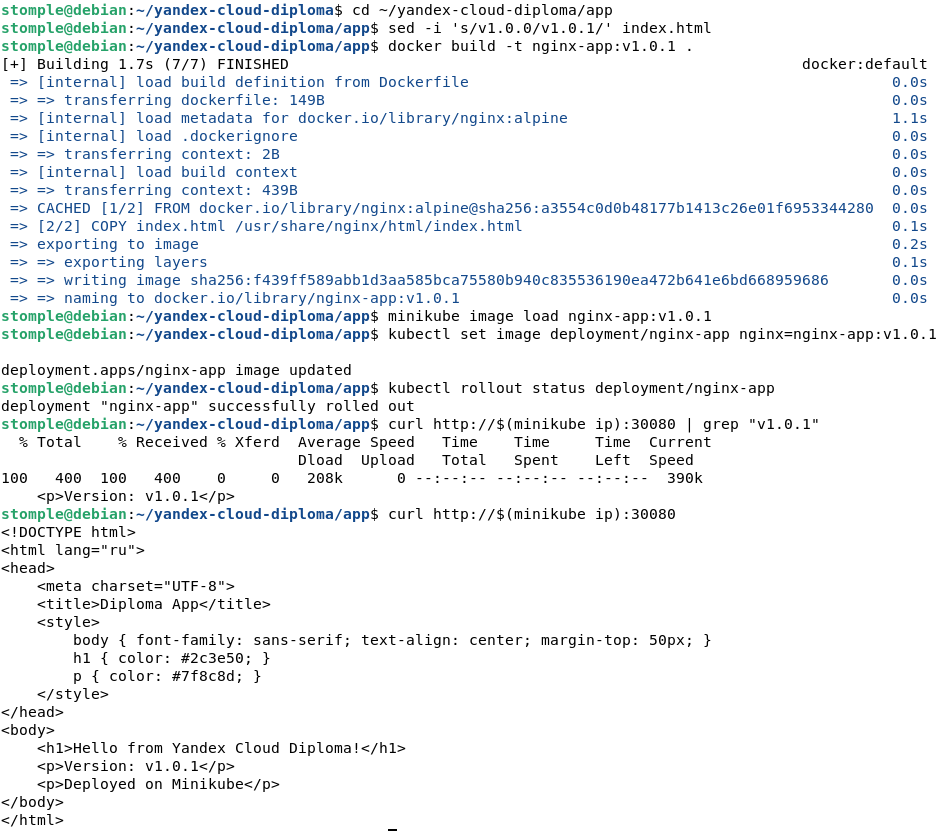

# Дипломный практикум в Yandex.Cloud

## Цели:
- Подготовить облачную инфраструктуру на базе облачного провайдера Яндекс.Облако.
- Запустить и сконфигурировать Kubernetes кластер.
- Установить и настроить систему мониторинга.
- Настроить и автоматизировать сборку тестового приложения с использованием Docker-контейнеров.
- Настроить CI для автоматической сборки и тестирования.
- Настроить CD для автоматического развёртывания приложения.

---

## Этапы выполнения:

### 1. Создание облачной инфраструктуры

**Задание:** Подготовить облачную инфраструктуру в ЯО при помощи Terraform. Создать сервисный аккаунт, подготовить backend (S3 bucket), создать VPC с подсетями в разных зонах доступности.

**Выполнение:**
Были установлены Terraform и Yandex Cloud CLI. Создан сервисный аккаунт `terraform-sa` с минимально необходимыми ролями (без прав суперпользователя). Настроен S3-бакет для хранения стейт-файла Terraform. Создана VPC-сеть с подсетями в разных зонах доступности.

*Скриншот создания ресурсов Terraform (SA, бакет):*

*Скриншот конфигурации backend.tf:*

---

### 2. Создание Kubernetes кластера

**Задание:** Создать Kubernetes кластер на базе предварительно созданной инфраструктуры. Обеспечить доступ к ресурсам из Интернета. Использовать прерываемые ВМ для worker nodes (для экономии).

**Выполнение:**
Был выбран вариант с использованием Yandex Managed Service for Kubernetes. 
*Примечание:* Из-за аварийного режима работы Yandex Cloud (последствия атак на дата-центры) создание воркер-нод в облаке зависало с ошибкой `DeadlineExceeded`. Поддержка подтвердила ограничения платформы. По рекомендации преподавателя, для выполнения практической части был развернут локальный кластер **Minikube**, на котором успешно выполнены все последующие этапы.

*Скриншот работающего локального кластера Minikube (нода в статусе Ready):*

---

### 3. Создание тестового приложения

**Задание:** Создать отдельный git репозиторий с простым nginx конфигом, который будет отдавать статические данные. Подготовить Dockerfile для создания образа приложения.

**Выполнение:**
Создано простое приложение на HTML (`app/index.html`), которое отдает статическую страницу. Написан `Dockerfile` на базе `nginx:alpine`. Образ собран локально, загружен в кластер и задеплоен.

*Скриншот запущенных подов приложения:*

*Скриншот работы приложения (версия v1.0.0):*

---

### 4. Подготовка cистемы мониторинга и деплой приложения

**Задание:** Задеплоить в кластер prometheus, grafana, alertmanager, экспортер основных метрик Kubernetes. Задеплоить тестовое приложение. Обеспечить Http доступ на 80 порту к web интерфейсу grafana и тестовому приложению.

**Выполнение:**
В кластер установлен Helm-чарт `kube-prometheus-stack`. Все компоненты (Prometheus, Grafana, Alertmanager) запущены и находятся в статусе `Running`. Настроен доступ к Grafana. Дашборды отображают метрики кластера.

*Скриншот подов мониторинга в статусе Running:*

*Скриншот авторизации в Grafana:*

*Скриншот дашборда с метриками Kubernetes:*

---

### 5. Установка и настройка CI/CD

**Задание:** Настроить автоматическую сборку docker образа при коммите в репозиторий с тестовым приложением. Настроить автоматический деплой при создании тега (например, v1.0.0).

**Выполнение:**
Настроен GitHub Actions. 
- Файл `ci.yml` запускается при пуше в ветку `main`, собирает Docker-образ и проверяет его работоспособность.
- Файл `cd.yml` запускается при создании тега (начиная с `v*`) и имитирует процесс деплоя.

*Скриншот успешного выполнения workflow в GitHub Actions:*

*Скриншот локальной демонстрации обновления версии приложения до v1.0.1 (rollout и проверка):*

---

## Что необходимо для сдачи задания?

1. **Репозиторий с конфигурационными файлами Terraform:** https://github.com/stomplego/yandex-cloud-diploma
2. **Репозиторий с Dockerfile тестового приложения:** находится в папке `/app` данного репозитория.
3. **Репозиторий с конфигурацией Kubernetes кластера:** находится в папке `/k8s` данного репозитория.
4. **Ссылка на тестовое приложение и веб интерфейс Grafana:** приложение и Grafana развернуты локально в Minikube. Скриншоты работы приложены выше.
5. **Скриншоты CI/CD:** приложены в разделе 5.

*Примечание к сдаче:* Облачная часть Yandex Cloud (воркер-ноды) не была завершена из-за официально подтвержденного форс-мажора (аварийный режим платформы Yandex Cloud, приостановка выдачи квот). По согласованию с преподавателем, оставшиеся этапы выполнены на локальном Kubernetes (Minikube).
